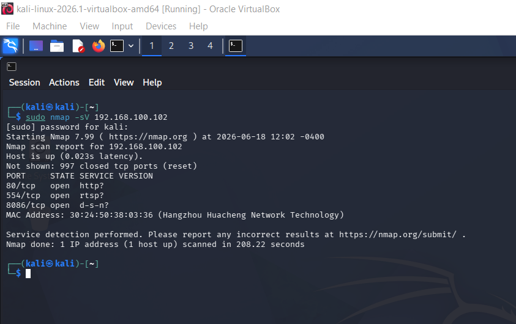
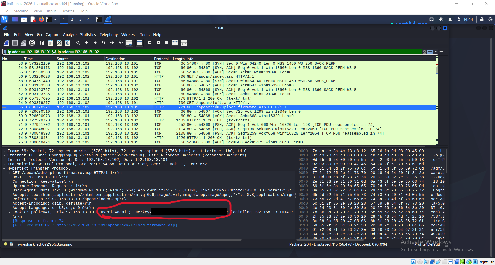
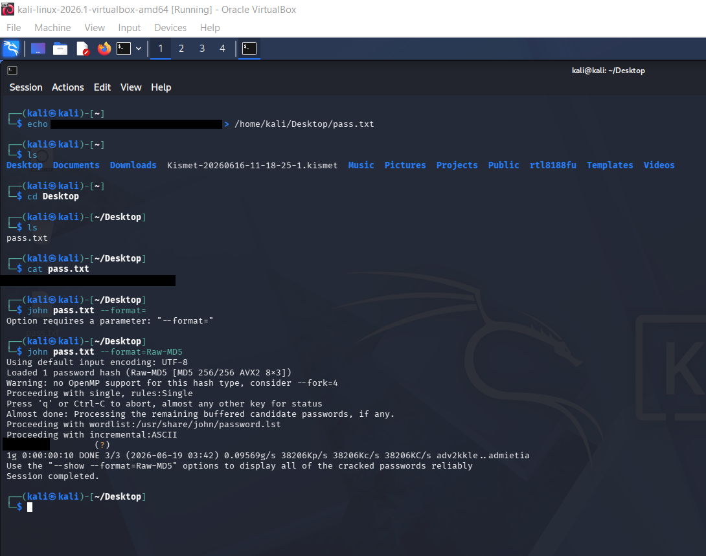
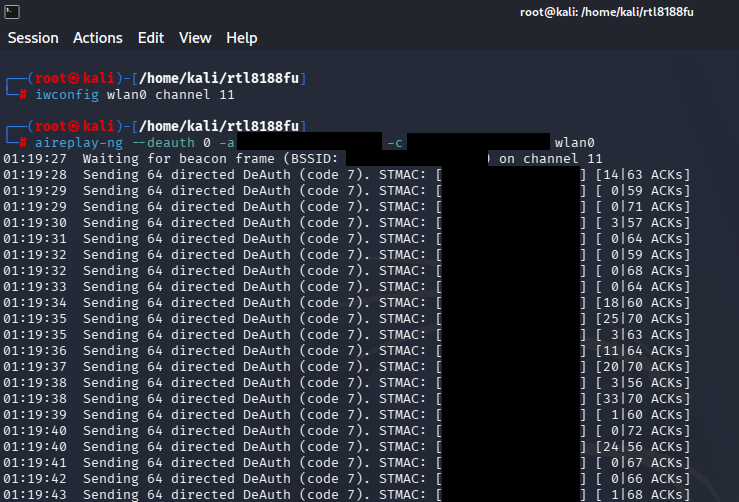
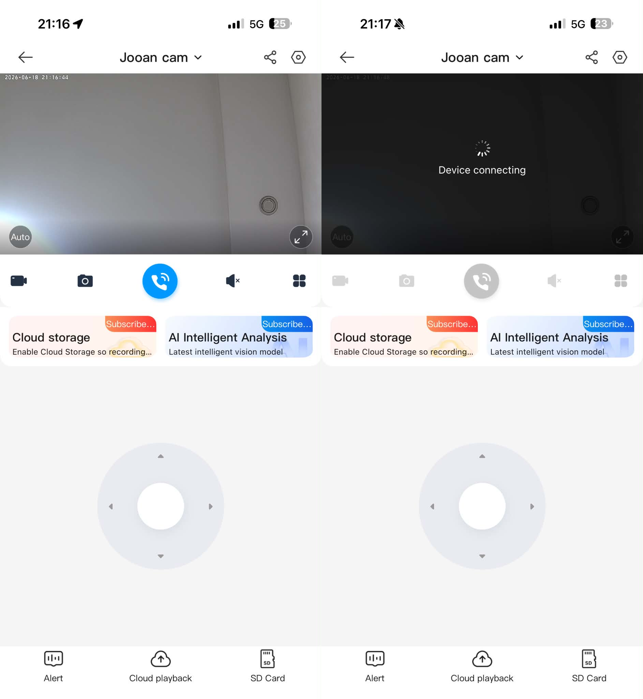
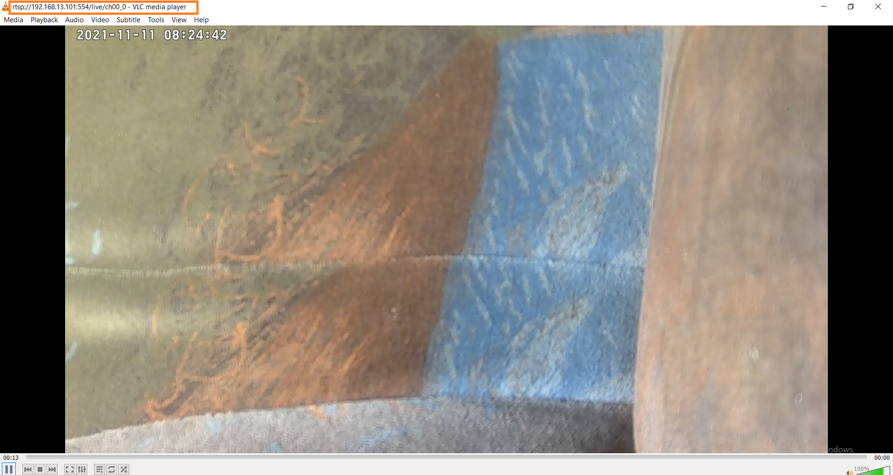

# IoT Surveillance Systems — Security Assessment & Ethical Hacking

**Master's thesis project | Technical University of Sofia | 2026**

A practical, controlled-lab security assessment of three consumer IoT surveillance cameras. The project explores network exposure, wireless availability, authentication and credential protection, access to video streams, physical access risks, and defensive improvements.

> **Scope and ethics:** Experiments were performed in a controlled academic environment. This repository documents methodology, observations and mitigations at a high level. It does not provide attack commands, reusable exploit instructions, credentials, packet captures or access to surveillance footage.

## Research objective

Evaluate how common security weaknesses affect the confidentiality, integrity and availability of consumer IP-camera systems, compare observations across three devices, and recommend appropriate mitigations. The findings describe **these tested devices under the tested conditions**, not an industry-wide vulnerability rate or a universal claim about every device of a given brand.

## Devices and environment

Three cameras were examined:

| Device | Ecosystem / management application |
|---|---|
| Reolink E Series E320 | Reolink |
| JOOAN A2R-U | CAM720 |
| Imou Ranger 2C | Imou Life |

The lab included an isolated local network, an end-user system, a Kali Linux testing environment and a compatible wireless adapter for controlled wireless experiments. See [Scope & methodology](docs/methodology.md).

## Tools and concepts

**Network discovery and analysis:** Nmap, Wireshark, TCP/IP, ARP, HTTP(S), RTSP, network-service exposure  
**Availability and wireless-security testing:** hping3, Aircrack-ng suite, wireless deauthentication concepts  
**Credential and stream security:** John the Ripper, VLC Media Player, authentication and streaming protocols  
**Security assessment:** threat modeling, STRIDE, DREAD, risk-oriented mitigation recommendations

Tools are listed because they appear in the thesis; inclusion does not imply that every tool was used successfully against every device.

## Assessment areas

1. **Network discovery and service enumeration** — investigated reachable devices, exposed services and differences in network behavior.
2. **Availability and resilience** — observed effects of network traffic stress and wireless deauthentication on stream continuity.
3. **Authentication and credential protection** — studied the handling of account credentials in the laboratory setup.
4. **Video-stream access** — assessed the consequences of exposed credentials and streaming-service accessibility.
5. **Physical access and device reassignment** — explored reset/re-enrollment behaviors requiring physical device access.
6. **Defensive evaluation** — discussed threat categories, practical mitigations and the limits of the observations.

## Selected observations

| Area | Observation | Scope / qualification |
|---|---|---|
| Wireless availability | All three test devices lost connectivity/video availability during the controlled deauthentication experiments | Does not establish a persistent compromise or universal exposure outside this laboratory setup |
| Network exposure | The devices exhibited different service-exposure profiles; the thesis highlights greater exposure on the tested JOOAN unit | An exposed service alone is not proof of an exploitable vulnerability |
| Credential security | In the JOOAN lab scenario, account-related values were observed in captured application traffic and a weak test password was recovered during an offline assessment | Not claimed for the Reolink or Imou units |
| Stream access | The JOOAN scenario demonstrated that knowledge of the relevant access details enabled viewing a video stream in the lab | No streams, access URLs or credentials are published here |
| Physical access | The assessment noted risks associated with physical reset and device re-enrollment | Requires physical access and should not be interpreted as an unauthenticated remote takeover |
| Protective behavior | The thesis notes attempts by Reolink and Imou devices to resist certain probes | Results are limited to the versions and conditions studied |

See [Findings & limitations](docs/findings.md) for a more detailed, appropriately qualified summary.

## Experimental Evidence

The following screenshots document selected experiments conducted during the master's thesis research. All testing was performed in a controlled laboratory environment using the assessed IoT surveillance devices.

### 1. Network Service Discovery — Nmap

Nmap was used to identify accessible network services and examine the exposed ports of the tested IP cameras. The results supported the assessment of each device's network exposure and potential attack surface.

### 2. HTTP Traffic Analysis — Wireshark

Wireshark was used to inspect communication between a tested camera and its management interface. The captured HTTP traffic revealed authentication-related parameters, demonstrating the importance of protecting credentials during transmission. Sensitive values have been redacted.

### 3. Password Security Assessment — John the Ripper

John the Ripper was used to assess the strength of a password associated with the laboratory environment. The experiment demonstrated the risks of weak credentials and the importance of secure password management.

### 4. Wireless Deauthentication Testing

A controlled wireless deauthentication experiment was performed to evaluate the availability of the tested camera's wireless connection. The observations highlighted the potential impact of wireless connectivity disruptions on surveillance systems. Device identifiers have been redacted.

### 5. Camera Availability — Before and During Testing

The screenshots compare the camera application's normal operating state with its behavior during a wireless deauthentication experiment. The application displayed a connection attempt instead of the live video feed, illustrating the observed temporary loss of availability.

### 6. RTSP Video Stream Access Validation

VLC Media Player was used to verify access to a camera's RTSP video stream in the controlled laboratory environment. This experiment supported the analysis of streaming access and authentication-related security considerations.

---

**Research scope:** These observations apply to the specific devices, configurations, and laboratory conditions evaluated in the thesis. They should not be interpreted as universal vulnerabilities affecting all devices from the respective manufacturers.

## Defensive recommendations

- Replace default credentials and use strong, unique passwords.
- Apply firmware and application updates promptly.
- Prefer encrypted management and transport channels wherever available.
- Separate IoT devices from sensitive systems using network segmentation or dedicated VLANs.
- Disable unnecessary remote access and services; restrict exposure at the network boundary.
- Protect devices against physical access, reset and unauthorized reassignment.
- Monitor device/network behavior and review configuration regularly.

A more detailed defensive checklist is available in [Security recommendations](docs/recommendations.md).

## Project documentation

- [Scope and methodology](docs/methodology.md)
- [Findings and limitations](docs/findings.md)
- [Security recommendations](docs/recommendations.md)
- [Publication / redaction checklist](docs/publication-checklist.md)

## About this repository

This is a **portfolio summary of an academic thesis**, not the complete thesis, a software product, an automated penetration-testing framework or a claim of discovered CVEs. The full thesis and raw lab materials are intentionally excluded from the repository. The evaluation was limited to three devices and particular configurations and test conditions.

**Author:** Aleks Kaloyanov Yonchev  
**Institution:** Technical University of Sofia  
**Year:** 2026
